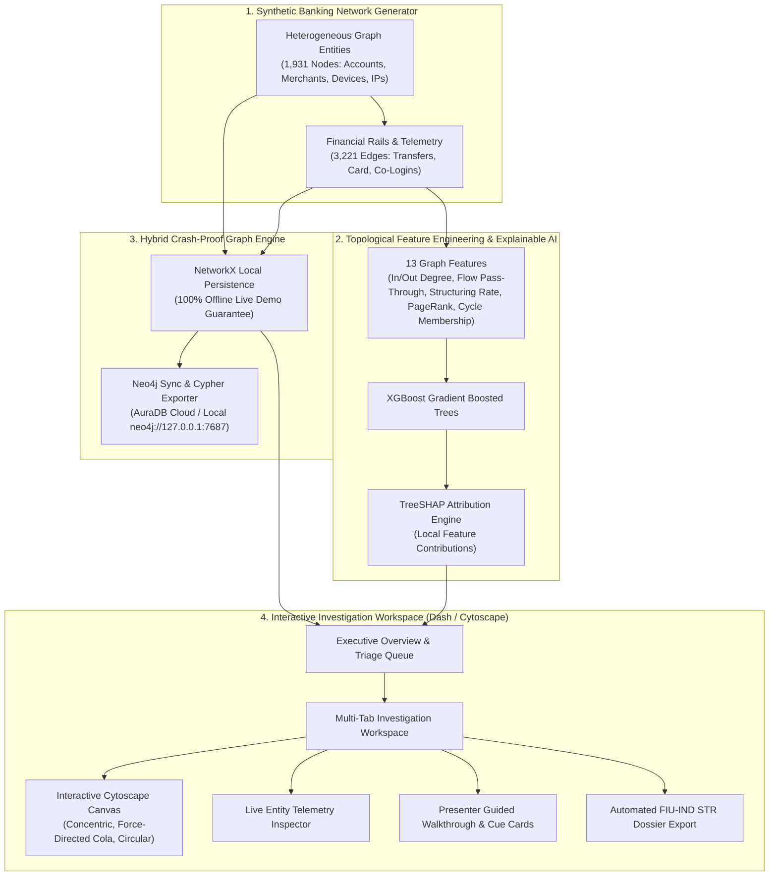

# FraudCircle 🌐🔍

[](https://www.python.org/)
[](https://dash.plotly.com/)
[](https://networkx.org/)
[](https://xgboost.readthedocs.io/)
[](https://fiuindia.gov.in/)
[](LICENSE)

> **"Detect the fraud ring, not just the fraudulent transaction."**

**FraudCircle** is an enterprise-grade financial crime intelligence and graph machine learning platform designed for modern banking compliance teams, financial intelligence units (FIU-IND), and anti-money laundering (AML) investigators.

Traditional rule-based monitoring inspects individual transactions in isolation (e.g., transactions $\ge$ ₹50,000). Organized criminal syndicates deliberately evade these thresholds using smurfing funnels, shared-device Sybil networks, circular flow rings, and sleeper bust-outs. FraudCircle shifts the detection paradigm from **isolated transactional alerts** to **holistic network topology**, unmasking criminal rings while suppressing false positives on high-volume legitimate business operations.

---

## 🏛️ Design Philosophy & Workspace Aesthetics

Inspired by modern investigative and analytical software (**Palantir Foundry**, **Linear**, and **Stripe Dashboard**):
* **Editorial Light Interface:** High-contrast surfaces (`#F4F1EA` parchment background, pure `#FFFFFF` cards, `#202A36` slate headers, `#2457A6` deep primary accent).
* **Zero Visual Clutter:** Crisp typography (`Inter`, `JetBrains Mono`), tactile action buttons, badge pill indicators, and subtle borders without neon glow or decorative AI noise.
* **Progressive Disclosure:** Investigators explore one case at a time, moving seamlessly from executive summary to graph evidence, topological telemetry, TreeSHAP attributions, and legal filing.
* **Deterministic Fact vs. AI Interpretation:** Clear visual boundaries separating observed ledger facts, topological calculations, model probability attributions, and regulatory thresholds.

---

## ⚙️ System Architecture



---

## 🎯 Case Studies & Typology Matrix

FraudCircle features 7 fully documented cases: 4 complex criminal typologies and 3 high-volume legitimate banking hubs to prove false-positive suppression:

| Case ID | Typology Category | Typology Classification | Volume at Risk | Severity | Traditional Rule Failure Mode | Graph ML Solution |
| :--- | :--- | :--- | :--- | :--- | :--- | :--- |
| **Case #1** | `FRAUD` | **Mule Structuring Funnel** | ₹48.9 Lakhs | **Critical** (94.2%) | Smurfs structure deposits under ₹50,000 threshold across 45 accounts. | Flow pass-through ratio $\approx$ 98.4% and fan-in concentration unmasks the consolidation master. |
| **Case #2** | `FRAUD` | **Sybil Ring to Shell Merchant** | ₹31.4 Lakhs | **Critical** (91.8%) | Accounts appear unconnected with independent KYC profiles. | Bipartite projection reveals 15 synthetic accounts sharing 1 MAC address & IP subnet. |
| **Case #3** | `FRAUD` | **Circular Flow / Round-Tripping** | ₹62.0 Lakhs | **Critical** (96.5%) | Each transfer looks like a regular B2B vendor payment. | Directed Cycle Detection ($C_k \le 8$) isolates closed loop returning capital to the initiator. |
| **Case #4** | `FRAUD` | **Sleeper Bust-Out Drain** | ₹18.5 Lakhs | **Critical** (88.7%) | Account maintains pristine transactional history for 29 days. | 48-hour velocity surge ($>10,000\%$) draining funds to 8 unverified 4-day-old accounts. |
| **Case #5** | `LEGIT` | **Corporate Payroll Hub** *(Infosys)* | ₹24.8 Lakhs | **Verified** (0.2%) | High out-degree ($1:50$) falsely flagged as structuring fan-out. | Model identifies 5-year corporate tax history, unique employee devices, and 0% return cycles. |
| **Case #6** | `LEGIT` | **Utility Provider Hub** *(Tata Power)* | ₹8.2 Lakhs | **Verified** (0.1%) | Extreme in-degree ($120:0$) triggers money laundering velocity rules. | Model recognizes micro-ticket utility bills from dispersed residential IPs into established merchant. |
| **Case #7** | `LEGIT` | **Family Wedding Spend Surge** | ₹14.0 Lakhs | **Verified** (0.4%) | Velocity spike on personal savings account triggers fraud freeze. | KYC tenure (>8 years), authorized payment gateways, and jewelry/catering merchant tags suppress alert. |

---

## 🎙️ Interactive Presentation Mode

Designed specifically for presenting to banking executives, evaluation panels, and compliance officers:
* **6-Step Progressive Narrative:** Every case features an editorial walkthrough:
  1. *What Happened?* (Modus operandi breakdown)
  2. *Follow the Money* (Interactive fund routing)
  3. *What Makes This Suspicious?* (Graph anomaly spotlight)
  4. *Why Did Traditional Rules Miss It?* (Compliance gap explanation)
  5. *How Did the Model Reach Its Score?* (TreeSHAP feature attributions)
  6. *What Should an Investigator Do Next?* (Actionable enforcement roadmap)
* **Synchronized Visual Halos:** As steps advance, Cytoscape highlights pertinent node clusters and dims unassociated entities to 20% opacity.
* **Presenter Speaking Cue Cards:** Real-time talking points, RBI regulatory context, and key topological ratios display directly in the UI.
* **Full Deck Controls:** `◀ Prev Step`, `Step X of 6`, `Next Step ▶` / `Finish Walkthrough ✓`, `Restart ↺`, and `Exit Presentation`.

---

## ⚖️ Indian Banking & Regulatory Compliance

1. **Reserve Bank of India (RBI):** Master Directions on Fraud Risk Management — automated suspicious graph identification and rapid asset containment.
2. **Financial Intelligence Unit - India (FIU-IND):** Instant generation and export of official **Suspicious Transaction Reports (STR)** in compliant JSON formats under Section 12 of the Prevention of Money Laundering Act (PMLA) 2002.
3. **Digital Personal Data Protection (DPDP) Act 2023:** Zero PII storage in client sessions; cryptographic pseudonymization of biometric and national identity attributes.
4. **Human-in-the-Loop (HITL) Controls:**
   * Section 35A Administrative Account Freezes.
   * False-Positive Whitelisting with Audit Trail Certificates.
   * Live Session Audit Logging with persistent case isolation.

---

## 🚀 Quick Start & Installation

### 1. Clone the Repository
```bash
git clone https://github.com/mayankk2402/FraudCircle.git
cd FraudCircle
```

### 2. Create and Activate a Virtual Environment
```bash
# Windows
python -m venv venv
venv\Scripts\activate

# macOS / Linux
python3 -m venv venv
source venv/bin/activate
```

### 3. Install Dependencies
```bash
pip install -r requirements.txt
```

### 4. (Optional) Regenerate Datasets & Retrain XGBoost Model
The repository comes with pre-generated datasets and pre-trained XGBoost weights. To regenerate from scratch:
```bash
python generate_fraud_data.py
python graph_feature_engine.py
python train_fraud_ai.py
```

### 5. Launch the FraudCircle Platform
```bash
# Windows Batch Launcher
run_dashboard.bat

# Or directly with Python
python app.py
```
Open **[http://127.0.0.1:8050](http://127.0.0.1:8050)** in any modern web browser.

---

## 🧪 Comprehensive Test Suite

FraudCircle includes 3 automated testing suites covering unit functionality, adversarial state transitions, and live E2E user journeys:

```bash
# 1. Core 18-Point Application Regression Suite
python test_regression.py

# 2. Adversarial QA Suite (State management, browser history, session persistence)
python test_adversarial_qa.py

# 3. End-to-End User Scenarios (Scenarios A through E)
python test_e2e_scenarios.py
```

All 33 programmatic tests run in `< 1.0s` with zero errors.

---

## 📂 Project Structure

```text
FraudCircle/
├── .github/
│   └── workflows/
│       └── ci.yml                     # Automated GitHub Actions CI pipeline
├── assets/
│   └── custom.css                     # Editorial Light design tokens and typography
├── data/
│   ├── Account_Features_FraudCircle.csv # 13 computed topological graph properties
│   ├── Edges_FraudCircle.csv          # 3,221 financial transactions and co-logins
│   ├── FraudCircle_Neo4j_Export.cypher # Exportable Cypher graph statements
│   ├── Model_Predictions_XAI.csv      # Risk probabilities and TreeSHAP values
│   ├── Model_Predictions_XAI.json     # Complete serialized model predictions
│   └── Nodes_FraudCircle.csv          # 1,931 accounts, merchants, devices, and IPs
├── models/
│   └── fraud_xgb_model.json           # Trained XGBoost gradient boosted model
├── app.py                             # Single canonical Plotly Dash application
├── generate_fraud_data.py             # Synthetic heterogeneous banking network generator
├── graph_feature_engine.py            # Real-time topological graph feature extractor
├── neo4j_sync.py                      # Offline fallback & live Neo4j AuraDB synchronization
├── train_fraud_ai.py                  # XGBoost model training and TreeSHAP attribution
├── test_adversarial_qa.py             # Adversarial stress & state navigation tests
├── test_regression.py                 # 18-point core regression test harness
├── test_e2e_scenarios.py              # End-to-end user scenario validation (A-E)
├── requirements.txt                   # Production dependency manifest
├── run_dashboard.bat                  # Windows launch script with BLAS thread safety
├── LICENSE                            # MIT License
└── README.md                          # Project documentation
```

---

## 📄 License

This project is licensed under the MIT License — see the [LICENSE](LICENSE) file for details.
